<!--
  ✏️  EDITING THIS FILE? Search (Ctrl+F) for "EDIT ZONE" to jump to the parts you change often.
  Full beginner guide: PROFILE-EDITING-GUIDE.md
-->

  <picture>
    <source media="(prefers-reduced-motion: reduce)" srcset="assets/hero-static.svg">
    
  </picture>

  <a href="https://github.com/Tanmay-Deore">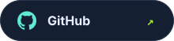</a>
  &nbsp;
  <a href="https://www.linkedin.com/in/tanmay-deore-309029408/">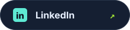</a>

<!-- ✏️ EDIT ZONE — TAGLINE (change the sentence below) -->

<i>Learning, building and improving every day.</i>

 

<!-- ═══════════ 02 · ABOUT ME ═══════════ -->


  Hey, I'm <b>Tanmay</b> — a first-year college student from Maharashtra who is getting into software development. 
  I learn best by building, so I'm exploring programming through hands-on projects instead of just watching tutorials. 
  Right now I'm laying down the foundations, and the goal is to become a full-stack developer who ships useful, real-world applications.

 

<!-- ═══════════ 03 · THE 20-DAY FOUNDATIONS SPRINT ═══════════ -->



<!--
  ╔══════════════════════════════════════════════════════════════╗
  ║  ✏️  EDIT ZONE 1 — SPRINT STATUS                             ║
  ║  Change only the words after the dash:                       ║
  ║      IN PROGRESS   →   COMPLETED                             ║
  ╚══════════════════════════════════════════════════════════════╝
-->
<table width="100%">
  <tr>
    <td width="33%" align="center">
       
      <code>HTML — IN PROGRESS</code>
    </td>
    <td width="33%" align="center">
      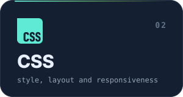 
      <code>CSS — IN PROGRESS</code>
    </td>
    <td width="33%" align="center">
      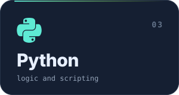 
      <code>Python — IN PROGRESS</code>
    </td>
  </tr>
</table>

<!-- ✏️ EDIT ZONE — SPRINT DATES (edit the two dates if your start day is different) -->

SPRINT WINDOW &nbsp;·&nbsp; <code>5 NOV 2026</code> → <code>25 NOV 2026</code>

<!--
  ✏️ EDIT ZONE — LEARNING LOG
  Add a new line at the TOP whenever something worth remembering happens.
-->

<b>Learning log</b>

- `2026-11-05` — Started the 20-day foundations sprint: HTML, CSS and Python
- `2026-11-02` — Pushed Avenza "Mineral Atlas v2.0" with living-field particle physics and interactive hero badges
- `2026-09-30` — Pushed PanicX, a deliberately chaotic crypto-trading interface

 

<!-- ═══════════ 04 · TECH STACK ═══════════ -->


<!--
  ✏️ EDIT ZONE 2 — TECH STACK
  To move a technology between groups, cut its  line and paste it into another group.
  To add one, copy any  line and change the file name (see assets/icons/).
-->

  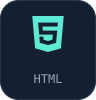
  
  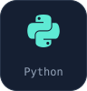

  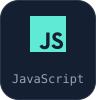
  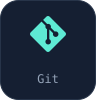
  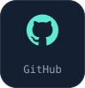

  
  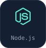
  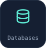

 

<!-- ═══════════ 05 · DEVELOPER ROADMAP ═══════════ -->

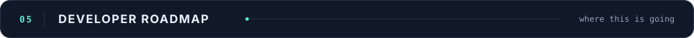

<!--
  ╔══════════════════════════════════════════════════════════════╗
  ║  ✏️  EDIT ZONE 3 — ROADMAP STATUS                            ║
  ║  Use one of:  IN PROGRESS · UP NEXT · PLANNED · COMPLETED    ║
  ╚══════════════════════════════════════════════════════════════╝
-->
<table width="100%">
  <tr>
    <td width="33%" align="center"><code>STAGE 01 — IN PROGRESS</code></td>
    <td width="33%" align="center"><code>STAGE 02 — UP NEXT</code></td>
    <td width="33%" align="center"><code>STAGE 03 — PLANNED</code></td>
  </tr>
</table>

 

<!-- ═══════════ 06 · FEATURED PROJECTS ═══════════ -->

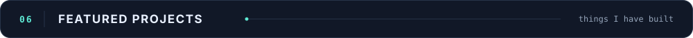

  <a href="https://github.com/Tanmay-Deore/Avenza">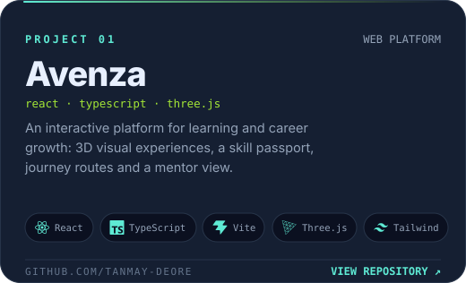</a>
  

<!-- ✏️ EDIT ZONE — PROJECT LINKS -->

  <a title="Open the Avenza repository" href="https://github.com/Tanmay-Deore/Avenza"><b>Avenza · Repository</b></a>
  &nbsp;&nbsp;·&nbsp;&nbsp;
  <a title="Open the PanicX repository" href="https://github.com/Tanmay-Deore/PanicX"><b>PanicX · Repository</b></a>
  &nbsp;&nbsp;·&nbsp;&nbsp;
  <a title="Open the PanicX live demo" href="https://panic-x.vercel.app/"><b>PanicX · Live demo</b></a>

 

<!-- ═══════════ 07 · CURRENTLY BUILDING ═══════════ -->


<!--
  ✏️ EDIT ZONE 4 — CURRENT FOCUS
  Edit the text in the right-hand column, and the label in the middle column.
-->
| Focus | Status | What's happening |
| :-- | :-: | :-- |
| **Building** | `IN PROGRESS` | **Avenza** — latest push added Mineral Atlas v2.0, living-field particle physics and interactive hero badges |
| **Exploring** | `ONGOING` | 3D on the web with Three.js and React Three Fiber, plus GSAP and Framer Motion animation |
| **Learning** | `IN PROGRESS` | HTML, CSS and Python (the 20-day sprint above) |

 

<!-- ═══════════ 08 · GITHUB ACTIVITY ═══════════ -->

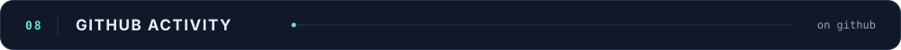

  

  

  <picture>
    <source media="(prefers-color-scheme: dark)" srcset="https://raw.githubusercontent.com/Tanmay-Deore/Tanmay-Deore/output/snake-dark.svg">
    
  </picture>

 

<!-- ═══════════ 09 · DEVELOPER MINDSET ═══════════ -->


 

<!-- ═══════════ 10 · CONTACT ═══════════ -->

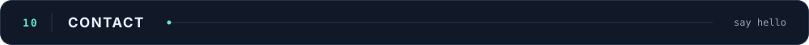

<!-- ✏️ EDIT ZONE — CONTACT LINKS (GitHub · LinkedIn · Email) -->

  
  &nbsp;
  
  &nbsp;
  

 

<!-- ═══════════ 11 · FOOTER ═══════════ -->

