

  

  

  
  
  

 

  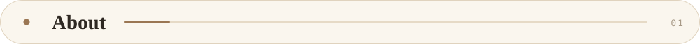

  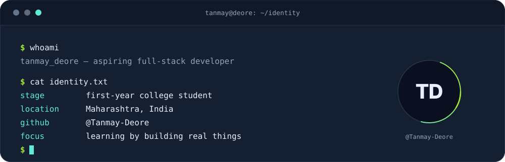

 

  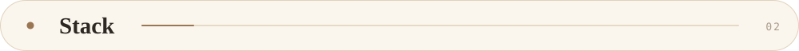

  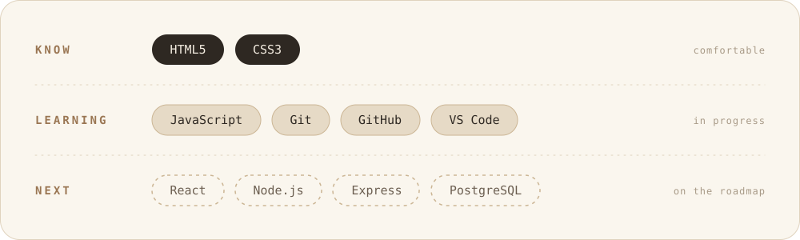

 

<!-- MY LEARNING ROADMAP -->

<h2 align="center">✦ THE LEARNING JOURNEY ✦</h2>

  BUILD &nbsp; • &nbsp; EXPLORE &nbsp; • &nbsp; CREATE

  <i>A roadmap of skills I'm building, one step at a time.</i>

<table width="100%">
  <tr>
    <td align="center" width="33%" bgcolor="#FAF6EE">
       
      <b>01 / CURRENT PHASE</b>
      <h3>FOUNDATIONS</h3>
      
        
      
        
      
        
      
        
      Building strong fundamentals.
       
       

<!-- MY LEARNING ROADMAP -->

<h2 align="center">✦ THE LEARNING JOURNEY ✦</h2>

  BUILD &nbsp; • &nbsp; EXPLORE &nbsp; • &nbsp; CREATE

  <i>A roadmap of skills I'm building, one step at a time.</i>

<table width="100%">
  <tr>
    <td align="center" width="33%" bgcolor="#FAF6EE">
       
      <b>01 / CURRENT PHASE</b>
      <h3>FOUNDATIONS</h3>
      
        
      
        
      
        
      
        
      Building strong fundamentals.
        
    </td>

    <td align="center" width="33%" bgcolor="#E6DAC6">
       
      <b>02 / NEXT PHASE</b>
      <h3>DEVELOPMENT</h3>
      
        
      
        
      
        
      
        
      Turning ideas into code.
        
    </td>

    <td align="center" width="33%" bgcolor="#FAF6EE">
       
      <b>03 / FUTURE PHASE</b>
      <h3>FULL STACK</h3>
      
        
      
        
      
        
      
        
      Creating complete applications.
        
    </td>
  </tr>
</table>

  ━━━━━━━━━━━━━━━━━━━━━━━━━━━━━━━━━━━━
   
  <b>CONSISTENCY OVER PERFECTION.</b>
   
  Every expert was once a beginner.

  
 

  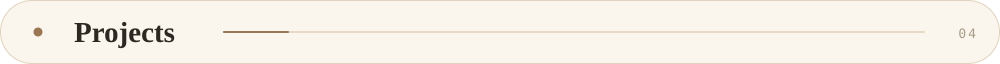

  
  
  

 

  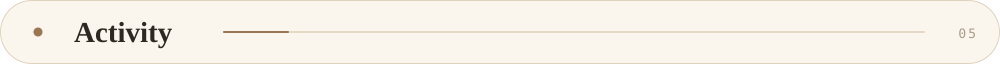

  

  

      

<!-- Contribution Snake -->

  <picture>
    <source media="(prefers-color-scheme: dark)"
      srcset="https://raw.githubusercontent.com/Tanmay-Deore/Tanmay-Deore/output/snake-dark.svg">
    <source media="(prefers-color-scheme: light)"
      srcset="https://raw.githubusercontent.com/Tanmay-Deore/Tanmay-Deore/output/snake.svg">
    
  </picture>

 

  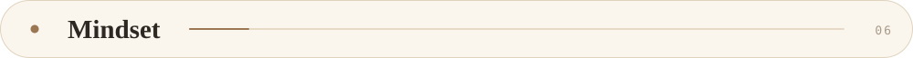

  

 

  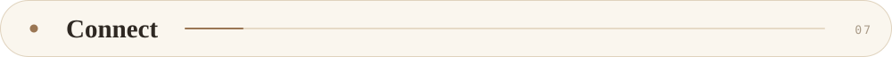

  

  

  

  

