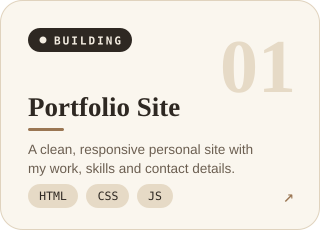
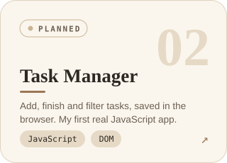
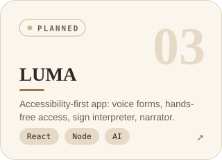

  

  

  
  
  

 

 

 

 

  
  
  

 

  
  

  

  <picture>
    <source media="(prefers-color-scheme: dark)" srcset="https://raw.githubusercontent.com/Tanmau_Deore/Tanmau_Deore/output/snake-dark.svg">
    
  </picture>

 

 

  
  
  

